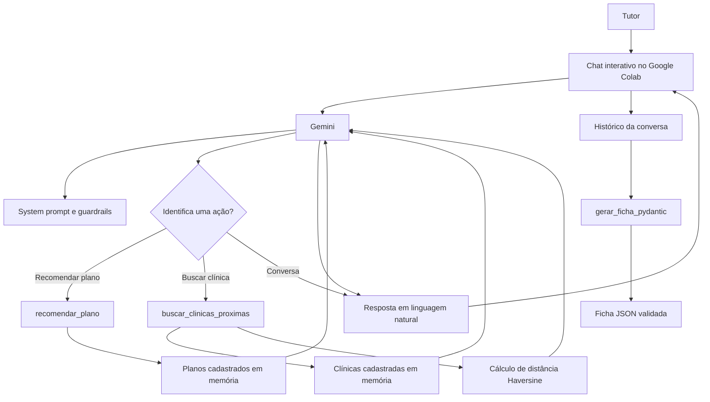

# Clyvo — Assistente Virtual de Saúde Pet

Projeto desenvolvido para o Challenge Clyvo Vet da disciplina **Disruptive Architectures: IoT, IoB & Generative AI**. A Clyvo é um chatbot especializado em saúde pet que orienta tutores na escolha de planos de saúde e localiza clínicas parceiras de acordo com a localização e a cobertura disponível.

> A implementação está no notebook [`ChallangeClyvo.ipynb`](./ChallangeClyvo.ipynb), desenvolvido e executado no Google Colab.

## Problema de negócio

Tutores precisam tomar decisões importantes sobre a saúde dos seus pets, como escolher uma cobertura compatível com idade, histórico clínico e orçamento, além de encontrar atendimento veterinário próximo em situações de necessidade.

A proposta da Clyvo centraliza essa jornada em uma conversa simples e contextualizada. O assistente coleta os dados relevantes, recomenda uma opção de plano, informa clínicas parceiras e transforma a conversa confirmada em uma ficha estruturada de contratação.

## Objetivos da solução

- Facilitar a escolha de um plano de saúde pet personalizado.
- Considerar idade, doença crônica, orçamento mensal e tolerância a risco.
- Localizar clínicas parceiras próximas usando latitude e longitude.
- Verificar se o plano analisado é aceito em cada clínica encontrada.
- Manter o contexto da conversa durante o atendimento.
- Validar os dados finais da contratação em um formato tipado e exportável.

## Abordagem de Inteligência Artificial

A solução combina **IA Generativa**, **function calling** e um **motor de regras**:

- **IA Generativa:** o modelo Gemini interpreta as mensagens do tutor, conduz o diálogo e gera respostas em linguagem natural.
- **System prompt e guardrails:** definem a persona da Clyvo, limitam o atendimento ao domínio de saúde pet e exigem confirmação antes da finalização.
- **Function calling:** o Gemini pode acionar funções Python quando identifica uma intenção compatível.
- **Motor de regras:** a recomendação de planos é calculada de forma determinística a partir dos dados coletados.
- **Pydantic:** extrai e valida os dados da conversa em uma ficha de contratação estruturada.

Essa combinação permite utilizar a flexibilidade da linguagem natural sem deixar decisões de negócio importantes exclusivamente a cargo do modelo.

## Funcionalidades

### Recomendação de plano

A função `recomendar_plano` recebe:

- idade do pet;
- existência de doença crônica ou tratamento contínuo;
- orçamento mensal máximo;
- tolerância a risco: `baixo`, `medio`, `medio-alto` ou `alto`.

Os planos atualmente cadastrados no notebook são:

| Plano | Valor mensal | Perfil e coberturas principais |
|---|---:|---|
| Clyvo Essencial | R$ 49,90 | Vacinas anuais, consultas de rotina e exames laboratoriais básicos |
| Clyvo Conforto | R$ 89,90 | Consultas ilimitadas, exames de imagem, vacinas e emergência 24h |
| Clyvo Plus | R$ 149,90 | Cirurgias, internação, especialistas e exames complexos |
| Clyvo Sênior & Especial | R$ 239,90 | Fisioterapia, acompanhamento especializado, UTI e medicamentos contínuos |

Em caso de doença crônica, a regra prioriza o plano Sênior & Especial. Quando o orçamento não permite essa opção, é indicado o plano mais completo dentro do valor informado.

### Busca de clínicas parceiras

A função `buscar_clinicas_proximas` recebe a latitude, a longitude, o identificador do plano e, opcionalmente, um raio máximo de busca. A distância é calculada pela fórmula de **Haversine** e os resultados são ordenados do mais próximo para o mais distante.

Para cada clínica, o chatbot informa:

- distância aproximada;
- disponibilidade de emergência 24 horas;
- especialidades;
- situação da cobertura: atendimento coberto ou atendimento com desconto/coparticipação.

### Ficha final de contratação

Depois da confirmação do tutor, o histórico completo é enviado à função `gerar_ficha_pydantic`. O resultado é validado pelo modelo `ContratacaoPlanoClyvo`, contendo:

- nome do tutor;
- nome do pet;
- espécie;
- idade;
- existência de doença crônica;
- plano escolhido;
- valor mensal.

## Arquitetura da solução



### Fluxo de dados

1. O tutor envia uma mensagem para o chatbot.
2. O Gemini interpreta a intenção usando o contexto e o `SYSTEM_PROMPT`.
3. Quando necessário, o modelo gera uma chamada para uma ferramenta autorizada.
4. A função Python consulta os dados locais de planos ou clínicas e retorna o resultado.
5. O resultado da função é devolvido ao Gemini para gerar uma resposta compreensível.
6. O histórico é mantido durante a sessão.
7. Após a confirmação dos dados, o histórico é convertido em uma ficha validada pelo Pydantic.

## Dados utilizados

| Dado | Origem atual | Utilização |
|---|---|---|
| Idade do pet | Informada pelo tutor | Filtrar planos compatíveis |
| Doença crônica | Informada pelo tutor | Priorizar cobertura especializada |
| Orçamento mensal | Informado pelo tutor | Restringir o valor da recomendação |
| Tolerância a risco | Informada pelo tutor | Comparar o perfil com o nível de cobertura |
| Latitude e longitude | Informadas pelo tutor | Calcular proximidade das clínicas |
| Planos e coberturas | Base estática no notebook | Executar a recomendação |
| Clínicas e especialidades | Base estática no notebook | Buscar parceiros e cobertura |
| Histórico da conversa | Memória da sessão | Gerar a ficha final |

Na versão atual, os dados de planos e clínicas são demonstrativos e ficam em estruturas Python em memória. Não há integração implementada com banco de dados, serviço de mapas, prontuário eletrônico ou API externa de clínicas.

## Tecnologias utilizadas

- Python 3
- Google Colab
- Google GenAI SDK (`google-genai >= 2.3.0`)
- Modelo Gemini (`gemini-3-flash-preview`, conforme configurado no notebook)
- Pydantic
- Function calling
- Fórmula de Haversine
- JSON

## Como executar

### Pré-requisitos

- Conta Google para acessar o Google Colab.
- Uma chave da API Gemini.
- Acesso ao notebook deste repositório.

### Execução no Google Colab

1. Abra [`ChallangeClyvo.ipynb`](./ChallangeClyvo.ipynb) no Google Colab.
2. Execute a primeira célula para instalar ou atualizar o SDK:

   ```python
   !pip install -q -U "google-genai>=2.3.0"
   ```

3. No Google Colab, abra **Secrets** e crie o segredo `GEMINI_API_KEY`.
4. Execute as células em ordem, da configuração do cliente até a célula de chat.
5. Interaja com a Clyvo pelo terminal exibido no notebook.
6. Digite `sair`, `fim` ou `encerrar` para finalizar o atendimento.
7. Execute a última célula para gerar a ficha de contratação em formato Python e JSON.

A chave da API deve ser mantida em segredo e não deve ser inserida diretamente no notebook ou publicada no repositório.

## Exemplo de interação

```text
Você: Quero um plano para meu cachorro de 9 anos, com doença crônica.
Clyvo: Para encontrar a melhor opção, qual é o seu orçamento mensal e sua tolerância a risco?
Você: Posso pagar até R$ 250 por mês e aceito risco alto.
Clyvo: Recomendo o plano Clyvo Sênior & Especial...
```

O fluxo real pode fazer perguntas adicionais, solicitar localização para a busca de clínicas e pedir confirmação explícita antes de gerar a ficha final.

## Resultados parciais

O protótipo demonstra:

- atendimento conversacional com memória de contexto;
- restrição do chatbot ao domínio da Clyvo por meio de guardrails;
- acionamento de funções Python pelo Gemini;
- recomendação baseada em critérios de negócio;
- busca de clínicas por distância;
- identificação de cobertura ou coparticipação;
- extração de dados da conversa para JSON validado pelo Pydantic.

## Limitações e próximos passos

- Substituir as listas estáticas por um banco de dados de planos, clínicas e contratos.
- Integrar uma API de geolocalização e mapas.
- Persistir o histórico e a ficha de contratação com autenticação e controle de acesso.
- Adicionar validações mais completas para localização, idade e dados cadastrais.
- Integrar dados clínicos reais, como vacinas, consultas e medicamentos, com consentimento do tutor.
- Adicionar testes automatizados para as regras de recomendação e para as ferramentas.
- Avaliar o modelo em produção, incluindo custo, latência, segurança e qualidade das respostas.

## Entrega

- **Notebook:** [`ChallangeClyvo.ipynb`](./ChallangeClyvo.ipynb)
- **Vídeo pitch:** inserir aqui o link não listado do YouTube.
- **Repositório:** este repositório contém o código-fonte e a documentação da solução.

## Integrantes da Equipe

| Nome do Aluno | RM | 
| :--- | :---: |
| *André Emygdio Ferreira*      | *RM565592* |
| *Gabriel Lourenço Martins*    | *RM562194* |
| *Giovane Amato dos Santos*    | *RM561336* |
| *Matheus Roque Arantes*       | *RM561959* |
| *Orlando Gonçalves de Arruda* | *RM561584* |
